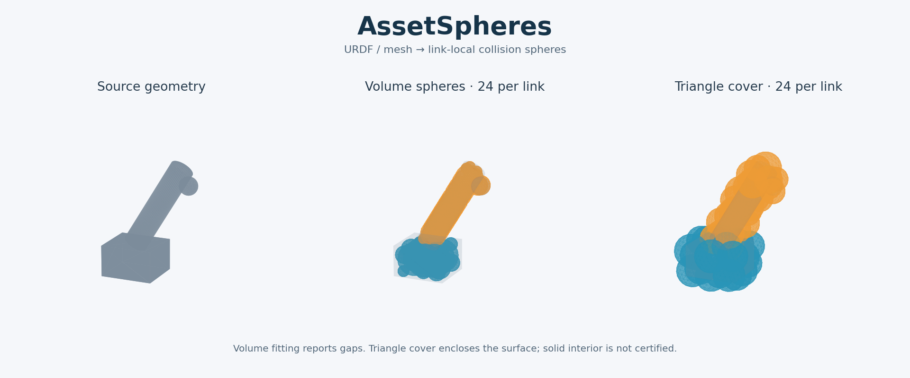

# AssetSpheres

把 **URDF 机器人资产或独立 mesh 资产转成碰撞球模型**。球心始终保存在所属 link 的局部坐标系，长度单位统一为米。默认后端只使用 CPU，不依赖 ROS、CUDA、Isaac Sim 或 cuRobo。

提供 Python API、命令行、Viser 查看与手动调整，以及 JSON / cuRobo / Lula 球配置片段 / 球碰撞 URDF / GLB 导出。



## 安装与运行

需要 Python 3.10+。在本仓库中执行：

```bash
python -m venv .venv
source .venv/bin/activate
python -m pip install -e '.[viewer]'

# 自带的双连杆示例，无需下载机器人 mesh
assetspheres methods
assetspheres inspect examples/two_link.urdf
assetspheres fit examples/two_link.urdf --method slab --count 24 --padding 0.003

# 打开 http://127.0.0.1:8890
assetspheres view outputs/two_link/spheres.json
```

`--count` 是**每个 link 的球数上限**，不是整台机器人的总数；候选球覆盖不再增加时可能提前结束。默认使用 collision，缺少 collision 的 link 才使用 visual。具体使用来源写入每个 link 的报告。

`fit` 可省略 `-o`，默认输出到 `outputs/<输入文件名>`；已有结果仍需显式 `--force`。完成后会显示可复制的 `report` / `view` 命令。`methods --json`、`inspect INPUT --json`、`report RESULT --json` 可供脚本读取。完整参数分组与错误约定见 [CLI 文档](docs/cli.md)，Python 用法见 [API 文档](docs/api.md)。

v0.3.1 优化了默认体素细分、CPU 距离评价和优化器内存、多组件距离查询及 GLB 实例共享，并修复 CUDA 栅格边界判定差异。实测范围、内存口径和性能取舍见 [本轮优化记录](docs/optimization.md)。

## 支持范围

- URDF：mesh、box、cylinder、sphere；一个 link 内的多份几何合并拟合。
- Mesh：STL、OBJ、PLY、GLB/GLTF 等 trimesh 能读取的三角 mesh。场景节点变换和重复实例会被展开；部分格式可能需要 trimesh 的可选解析依赖。
- 正确处理 URDF mesh 的非均匀 `scale`、geometry 的 `origin xyz/rpy`，并保留原始 link/joint 结构。
- 相对路径、绝对路径、`file://` 和显式映射的 `package://`；也支持 `ROS_PACKAGE_PATH`。
- 预览使用所有 joint 位置为零时的装配变换；不求解 mimic offset，不提供运动仿真。拟合本身不受 joint 姿态影响。
- Xacro 请先展开为 URDF；当前不直接读取 USD、MJCF 或 STEP。

## 拟合方法

| 方法 | 实现与用途 | 需要闭合 mesh | 覆盖含义 |
| --- | --- | --- | --- |
| `voxel`（默认） | 体素填充、距离场候选球、贪心选择；适合实体 link | 是 | 近似体积覆盖，会留下缝隙 |
| `surface` | 面积加权采样、最远点选择、固定球半径；适合薄片和附着物 | 否 | 表面采样，不保证整体包络 |
| `cover` | 三角形分组后构造包络球；适合希望覆盖完整三角表面的情况 | 否 | 包含整个三角形表面；不证明覆盖实体内部 |
| `cover-tight` | 固定原三角形分组，用小支持集数值优化包围球中心 | 否 | 保留三角表面包络，逐簇半径不增加（数值舍入除外） |
| `slab` | 按主轴完整裁剪三角形，每个平行切片用一个球包络 | 否 | 完整表面包络；曲面为有界实体边界时，构造也覆盖内部 |
| `refined`（实验） | 从体素球初始化，联合优化中心与半径，权衡覆盖和外扩 | 是 | 有限样本优化，无连续覆盖保证；CPU/CUDA 同目标 |
| `lula` | 调用当前解释器中的原生 Lula `CollisionSphereGenerator` | 是 | 与安装版本及 mesh 拓扑有关 |

`voxel` 是本项目独立实现的体积球化算法，`surface` 参考 IsaacLab/cuRobo 的表面球化用途。它们不宣称复现 Lula 未公开的内部实现。只有 `--method lula` 会调用原生 Lula。

开口 mesh 在体积后端中默认报错。可修复资产，或显式允许回退：

```bash
assetspheres fit robot.urdf --non-watertight cover -o outputs/robot
```

体素化会填充封闭壳的内部；完全封闭的内部空腔可能被填实。细小孔洞和薄壁会受体素分辨率影响。当前不自动取凸包，也不自动删除小部件。

`slab` 对细长 link 更有优势，对横截面包含多个分支或孔洞的形状可能外扩明显。它的实体包络结论有明确几何前提和浮点裕量，不是区间算术形式证明。URDF 的 sphere/cylinder 会先三角化，所有几何保证针对参与拟合的三角 mesh。

## CPU 并行与 CUDA

```bash
# CPU：按 link 并行，默认仍串行；线程通常比短任务的新进程更划算
assetspheres fit robot.urdf --method cover-tight \
  --workers 4 --executor thread -o outputs/threaded

# 细长 link 的保守包络
assetspheres fit robot.urdf --method slab --count 24 -o outputs/slab

# 已有兼容 CUDA 的 PyTorch 环境时，GPU 做候选覆盖与距离评价
assetspheres fit robot.urdf --method voxel --device cuda -o outputs/cuda

# GPU 联合优化（实验性；不等同于原生 MorphIt）
assetspheres fit robot.urdf --method refined --device cuda \
  --iterations 120 --refine-samples 2048 --outside-weight 10 -o outputs/refined

# 单一闭合曲面的原始 mesh 内外监督，需要 quality extra 中的 rtree
assetspheres fit part.stl --method refined --refine-reference mesh -o outputs/refined-mesh
```

PyTorch 是可选依赖，使用 CUDA 前需按机器安装兼容构建；也可通过 `pip install -e '.[cuda]'` 安装，但 CUDA 可用性仍取决于具体 PyTorch 构建和驱动。`--device cuda` 只用于 `voxel` / `refined`，明确请求后不静默回退。CUDA 模式保持一个 GPU 执行者，不能同时开启多个 link worker。

默认 `subdivide` 的三角细分和 EDT 仍在 CPU；候选球选择、距离评价和 `refined` 优化可以在 CUDA 执行。新增可选 `--voxelizer warp --device cuda` 还可把原 mesh 的距离查询移到 GPU，省掉该路径的细分和 EDT。输入读取、候选数组准备和导出仍有 CPU 工作，小任务冷启动也可能更慢。旧版本线程/进程与 CUDA 基准见 [v0.2 实验](docs/performance.md)，新后端见 [体素化与易用性改进](docs/voxelizer-performance.md)。

`refined` 默认使用体素内外标签，速度较快但受边界栅格偏差影响；`--refine-reference mesh` 使用原三角表面的内外查询，通常能降低外扩但增加准备时间，仅支持单个闭合表面体，并假设没有自交。`--outside-weight` 越大越偏向限制外扩，不能保证覆盖率同时提升。优化还有一个 `0.15 × voxel_size` 的正样本目标裕量，它与最后添加的用户 padding 分别记录。

## 可选的原 mesh 距离后端

```bash
# Open3D 使用 CPU；不要求 PyTorch
python -m pip install -e '.[open3d]'
assetspheres fit part.stl --voxelizer open3d

# Warp 可在 CPU 或 CUDA 查询几何；CUDA 张量阶段还需兼容的 PyTorch
python -m pip install -e '.[warp,cuda]'
assetspheres fit part.stl --voxelizer warp --device cuda --padding 0.003

# 多闭合组件显式按实体并集解释；这会填实嵌套壳的空腔
assetspheres fit robot.urdf --voxelizer warp --device cuda \
  --voxel-solid-policy union-components --method refined
```

新后端使用**严格内部格点和原 mesh 距离半径**，与旧的表面壳填充/EDT 不同，不能只比较速度后自动替换。它们通常减少外扩，但原始 `voxel` 的表面覆盖可能降低；仍需检查报告或选择 `refined` / 表面包络方法。默认 `single` 要求一个闭合表面体，遇多壳会提示明确实体语义。

每个组件没有内部格点时会报出薄壁/分辨率问题；有样本的小组件会保留最深内部代表点，球预算不足或优化后丢掉代表点也会明确失败。这个检查只确保组件代表点没有消失，不证明整个组件被覆盖。查询几何使用居中归一化的 float32，并考虑最终球心的物理坐标舍入；精度不足时建议先把 mesh 移近原点。

## 常用命令

```bash
# URDF：指定 ROS package 根目录、几何来源与 link 球数
assetspheres fit /path/to/robot.urdf \
  --package-root robot_description=/path/to/robot_description \
  --geometry collision --count 24 \
  --link-count wrist=12 --link-count gripper=40 \
  --voxel-size 0.004 --padding 0.002 -o outputs/robot

# 只处理指定 link（可重复 --link）
assetspheres fit /path/to/robot.urdf \
  --link forearm --method cover --count 16 -o outputs/forearm

# 独立 STL：输入以毫米建模时，显式转换为米
assetspheres fit /path/to/part.stl \
  --scale 0.001 --method cover --count 32 -o outputs/part

# 固定半径表面球
assetspheres fit /path/to/object.obj \
  --method surface --surface-radius 0.012 --count 100 -o outputs/object

# 查看报告或导出修改后的结果
assetspheres report outputs/robot/spheres.json --json
assetspheres export outputs/robot/spheres.edited.json -o outputs/robot-edited
```

重复导出到已有目录需加 `--force`；即使指定 `--force`，输出也不能覆盖源资产及 URDF 引用的 mesh/纹理。已有输出在拟合前检查。`--resolution` 默认是最长轴 48 格，`--voxel-size` 可覆盖它；网格大小在体素化前检查，默认限制 200 万格。

Viser 会自动取景，可用 `Frame model` 重新对准当前模型或单独显示的 link。可以切换 link、切换 mesh / 球 / 线框、调整球透明度、球心和半径，并保存为新的 JSON。编辑时复用已有几何对象。手动调整后，原有覆盖率会标记为失效；再次执行 `export` 更新各类导出文件。

## 输出文件

| 文件 | 含义 |
| --- | --- |
| `spheres.json` | 版本化结果、link 局部球参数、拟合配置、报告、预览用零位变换 |
| `curobo_spheres.yml` | cuRobo 外部球文件结构：`collision_spheres: {link: [...]}` |
| `lula_spheres.yml` | Lula 描述中的球片段：`collision_spheres: [{link: [...]}]` |
| `spheres.urdf` | 用球替换已处理 link 的 collision；保留 visual、inertial、joint 和未处理 link |
| `preview.glb` | 零位姿下 mesh 与球的静态叠加，可用 `--no-glb` 关闭 |

两份 YAML 都是**球配置片段**，还需与目标系统的机器人运动学、关节和规划配置组合。导出的 URDF 会将保留的 mesh 路径改写成相对输出文件的路径；mesh 和纹理不复制，移动资产时需一并维护路径。独立 GLB 等格式是否能被目标 URDF 消费者读取，取决于其 mesh 格式支持。

`spheres.json` 记录本地源文件位置和 package 映射，供后续预览使用。移动输入文件后，可通过 `view` / `export` 的 `--asset` 与 `--package-root` 覆盖位置。静态 GLB 可独立分享。

## Python API

```python
from assetspheres import FitConfig, fit_asset, load_asset
from assetspheres.export import write_outputs

asset = load_asset(
    "robot.urdf",
    package_roots={"robot_description": "/path/to/robot_description"},
)
result = fit_asset(
    asset,
    FitConfig(method="voxel", count=24, resolution=48, padding=0.003),
    link_counts={"wrist": 12},
    workers=4,
    executor="thread",
)
for link_name, spheres in result.links.items():
    print(link_name, [(s.center, s.radius) for s in spheres])
write_outputs(asset, result, "outputs/robot")
```

单个 trimesh 对象可用 `fit_mesh(mesh, config)`，返回 `(list[Sphere], report)`。

## 质量报告

- `surface_coverage`：独立面积加权表面样本被球并集包含的比例。
- `surface_gap_mean_m / p95_m / max_m`：未覆盖表面到球并集的正距离，已覆盖样本按零计。
- `voxel_center_coverage`：`voxel` 方法对所有填充体素中心的覆盖比例，不是连续实体的覆盖证明。
- `sphere_volume_sum_m3`：各球体积之和，**包含重复计算的重叠部分**，不是球并集的体积。

表面采样得到 100% 不代表连续表面或实体内部都被覆盖。`cover` 另行提供三角形表面覆盖的构造保证，其代价是球可能明显突出原 mesh。碰撞检测使用前应根据任务检查球预算、padding、间隙和外扩量。

`assetspheres.quality.compare_sphere_models` 可对多种结果使用相同的独立样本，报告实体覆盖率、外扩体积/原 mesh 体积、球并集 precision 和 IoU；需要 `pip install -e '.[quality]'`。评价域包含原 mesh 及所有被比较的球，避免漏掉包围盒外的外扩。多闭合壳默认跳过实体评价，调用方必须明确选择奇偶壳语义或逐组件并集语义；后者会填掉嵌套空腔。自交检测尚未实现。

## 使用原生 Lula

在已安装并启用 Lula 扩展、可 `import lula` 的 Isaac Sim Python 环境中安装本仓库，然后运行：

```bash
python -m assetspheres fit robot.urdf --method lula --count 24 --padding 0.002 -o outputs/lula
```

AssetSpheres 不启动 SimulationApp，也不尝试通过 pip 安装同名的其他 `lula` 包。原生后端需要由调用方准备好对应的 Isaac Sim 运行时。当前环境的原生 Lula 未安装；适配器已做接口契约测试，实际运行仍需在相应版本中验证。

## 开发与参考

```bash
python -m pip install -e '.[dev,viewer]'
pytest -q
ruff check .
ruff format --check .
python -m build
```

若机器上的 ROS 全局 pytest 插件与 pytest 版本冲突，可用 `PYTEST_DISABLE_PLUGIN_AUTOLOAD=1 pytest -q` 运行本项目的独立测试。

静态对比图可通过 `pip install -e '.[plots]'` 后执行 `python examples/render_comparison.py` 重现。当前本地验证记录见 [docs/validation.md](docs/validation.md)。

算法、坐标规则和参考边界见 [docs/algorithm.md](docs/algorithm.md)。参考的主要实现为 [IsaacLab cuRobo planner](https://github.com/isaac-sim/IsaacLab/blob/main/source/isaaclab_mimic/isaaclab_mimic/motion_planners/curobo/curobo_planner.py)、[Lula 编辑器](https://docs.isaacsim.omniverse.nvidia.com/latest/manipulators/manipulators_robot_description_editor.html) 与 [Lula API](https://docs.isaacsim.omniverse.nvidia.com/6.1.0/py/source/deprecated/isaacsim.robot_motion.lula/docs/index.html)。用户提供的[知乎回答](https://www.zhihu.com/question/2096010351653435323/answer/2097772625942655119)目前无法读取，尚未据此实现或声称复现其方法。

许可证：[Apache-2.0](LICENSE)。不附带第三方机器人资产；示例由本项目生成。
