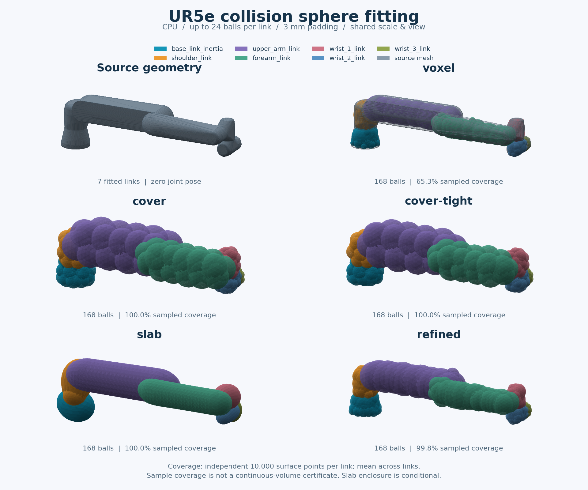
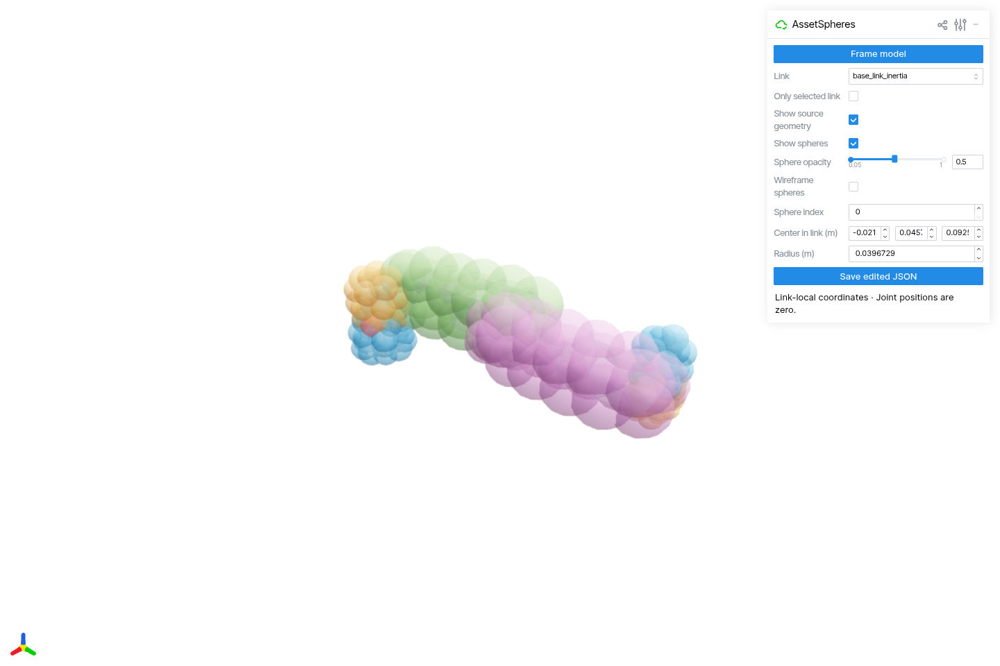
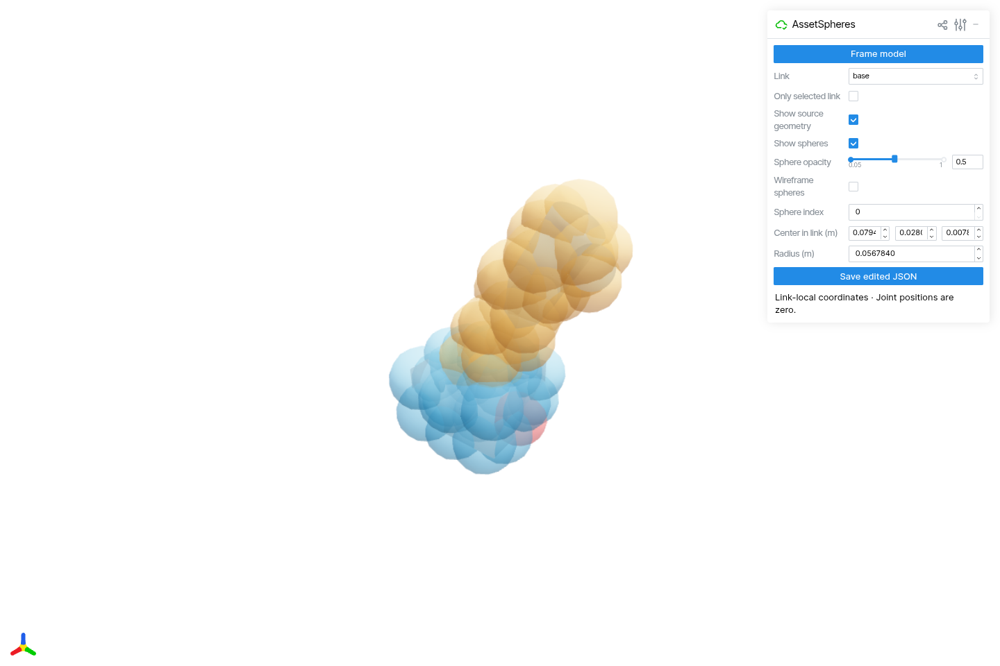

# AssetSpheres

将 **URDF 机器人或独立三角网格（mesh）转换成碰撞球模型**，用于机器人碰撞几何准备。
球心保存在所属 link 的局部坐标系，长度单位统一为米。

提供命令行、Python API、Viser 交互编辑，以及 JSON、cuRobo / Lula 球配置片段、URDF 和 GLB 导出。
默认使用 CPU，无需 ROS、CUDA 或 Isaac Sim。

[快速开始](#快速开始) · [方法选择](#方法选择) · [效果预览](#效果预览) · [自己的资产](#处理自己的资产) ·
[Python API](#python-api) · [结果与编辑](#查看和使用结果) · [文档](#文档与开发)

## 快速开始

需要 **Python 3.10+**。以下命令使用 Bash；安装后均在仓库根目录执行。

```bash
git clone https://github.com/chase6305/AssetSpheres.git
cd AssetSpheres
python -m venv .venv
source .venv/bin/activate
python -m pip install -e '.[viewer]'
```

自带示例无需下载其他机器人资产。先检查几何，再用 `cover` 生成三角表面包络球：

```bash
assetspheres inspect examples/two_link.urdf
assetspheres fit examples/two_link.urdf --method cover \
  --count 24 --padding 0.003 -o outputs/demo
assetspheres report outputs/demo/spheres.json
assetspheres view outputs/demo/spheres.json
```

打开 **<http://127.0.0.1:8890>** 查看结果。查看器会自动取景，可切换 link、显示源网格和球，或调整球心、半径。

- `--count 24` 表示**每个 link 最多 24 个球**；实际数量可能更少。
- `--padding 0.003` 表示最终半径增加 **3 mm**。
- 示例输出位于 `outputs/demo/`。重新生成同一目录的结果时，加 `--force`。

不需要交互查看器时，安装 `python -m pip install -e .` 即可使用核心拟合和导出功能。

## 方法选择

| 方法 | 适用目标 | 网格要求 | 覆盖含义 |
| --- | --- | --- | --- |
| `voxel`（默认） | 体素化后用球近似实体体积 | 闭合 | 近似体积覆盖，可能留缝 |
| `surface` | 薄片、表面附着物、固定半径球 | 可开口 | 覆盖采样点附近，不保证完整包络 |
| `cover` | 包住完整三角表面 | 可开口 | 三角表面包络，不证明实体内部覆盖 |
| `cover-tight` | 缩紧 `cover` 的同一三角分组 | 可开口 | 保留表面包络，通常更紧 |
| `cover-opt` | 重新分组三角形，进一步减小球体积之和 | 可开口 | 保留表面包络，需要额外拟合时间 |
| `slab` | 沿主轴切片，适合细长 link | 可开口 | 表面包络；满足有界实体边界假设时也覆盖内部 |
| `refined`（实验） | 从体素球初始化，权衡覆盖与外扩 | 闭合 | 有限样本优化，无连续覆盖保证 |
| `refined-cover`（实验） | 优化后修补完整三角表面 | 闭合 | 球心不变、半径只增，不证明实体内部覆盖 |
| `lula` | 调用已安装的原生 Lula 生成器 | 闭合，需 Lula 运行时 | 取决于原生实现和输入拓扑 |

`cover` 的球可能明显突出原网格；`slab` 在多分支、孔洞或宽横截面上也可能外扩较多。
URDF 的球和圆柱会先三角化，几何保证针对实际参与拟合的三角网格。
各方法的构造、浮点假设与限制见[算法说明](docs/algorithm.md)。

进一步优化见 [表面修补与机械臂实测](docs/refined-cover.md)及
[三角形重分组对比](docs/cover-optimization.md)。修补会增加 `refined` 的外扩；
要求实体包络时，仍需检查 `slab` 的适用假设与外扩。

可用 `assetspheres methods` 比较方法，或用 `assetspheres fit --help` 查看参数。

## 效果预览

### 真实机械臂：UR5e

以下是 UR5e 的实际 CPU 拟合结果，使用 7 个闭合 collision link 和零位姿（各关节为 0）。
每个 link 最多 24 球，共生成 168 球；padding 为 3 mm，种子为 0，其余参数使用默认值。
颜色区分各 link，各面板采用相同尺度与视角。



在每个 link 独立取 10,000 个表面验证点后，覆盖比例的算术平均值为：

| 方法 | 表面样本覆盖率 |
| --- | --- |
| `voxel` | 65.3% |
| `cover` / `cover-tight` / `slab` | 100.0% |
| `refined` | 99.8% |

这些数值对应本图的输入、球预算和参数，不代表对任意资产的排名；采样覆盖率也不是连续实体覆盖证明。
[完整配置、逐 link 结果和球参数](docs/ur5e-comparison.json) · [模型来源与许可](docs/third-party-assets.md)

准备好展开后的 UR5e URDF 和对应 mesh 后，可重新生成：

```bash
python -m pip install -e '.[plots]'
python examples/render_comparison.py \
  --input /path/to/ur5e/robot.urdf --geometry collision \
  --title "UR5e collision sphere fitting" --columns 2 --zoom 2.2 \
  --output docs/ur5e-comparison.png
```

自定义 `--output` 会同时生成同名 `.json`。机械臂资产需要另行准备，不随本仓库分发；
也可将 `--input` 换成自己的 URDF。下面的双连杆示例无需外部资产。

<details>
<summary>查看自带双连杆的对比结果与复现命令</summary>

下图由自带双连杆资产的**实际 CPU 拟合结果**生成：每个 link 最多 24 球、padding 3 mm、种子 0，
其余参数使用默认值。各面板使用相同尺度与视角；青色是 base 球，橙色是 arm 球，灰色是源网格。


图中覆盖率来自每个 link 独立生成的 10,000 个表面验证点，显示两个 link 覆盖比例的算术平均值。
`cover` / `cover-tight` 包络三角表面，`slab` 在该示例的底座上外扩较明显；`refined` 在本例中提高了
表面样本覆盖比例，但没有连续覆盖保证。图中 100% 仅表示验证样本全部被覆盖，不能作为连续实体覆盖证明。

在相同依赖版本下，可用以下命令重新生成图和[参数、球模型及验证数据](docs/visual-examples.json)：

```bash
python -m pip install -e '.[plots]'
python examples/render_comparison.py
```

</details>

## 处理自己的资产

支持 URDF 的 mesh、box、cylinder、sphere，以及 Trimesh 可读取的 STL、OBJ、PLY、GLB/GLTF 等三角网格。
一个 link 内的多份几何会合并拟合；独立场景网格的节点变换和重复实例会展开。
部分文件格式需要额外解析依赖。

```bash
# URDF：为 package:// 路径指定包根目录，单独调整 wrist 的球数上限
assetspheres fit /path/to/robot.urdf \
  --package-root robot_description=/path/to/robot_description \
  --count 24 --link-count wrist=12 --padding 0.002 -o outputs/robot

# 只处理一个 link；可重复 --link 选择多个
assetspheres fit /path/to/robot.urdf \
  --link forearm --method cover --count 16 -o outputs/forearm

# 独立 mesh：将毫米转换为米
assetspheres fit /path/to/part.stl \
  --scale 0.001 --method cover --count 32 -o outputs/part
```

**几何来源与坐标。** 默认 `--geometry auto` 优先使用 collision；该 link 没有 collision 时才使用 visual。
可用 `--geometry collision` 或 `--geometry visual` 明确选择。URDF mesh 的非均匀 `scale`、geometry 的
`origin xyz/rpy` 会在加载时应用；`--scale` 只用于独立 mesh 的单位换算。

**路径与输出。** 支持相对路径、绝对路径、`file://`、`package://` 和 `ROS_PACKAGE_PATH`。
省略 `-o` 时输出到 `outputs/<输入文件名，不含扩展名>/`。已有结果需要 `--force`，源资产及其
URDF mesh / 纹理引用始终受覆盖保护。Xacro 需先展开；目前不直接读取 USD、MJCF 或 STEP。

**开口与薄壁网格。** 体积方法遇到开口网格时默认报错，可显式回退：

```bash
assetspheres fit /path/to/robot.urdf --non-watertight cover -o outputs/robot
```

默认体素化可能填实封闭空腔，薄壁和小孔会受分辨率影响。`--resolution` 默认为最长轴 48 格，
`--voxel-size` 可指定米制格距并覆盖它；默认网格上限为 200 万格。完整参数见 [CLI 文档](docs/cli.md)。

## Python API

同样使用自带示例，可直接在仓库根目录执行：

```python
from assetspheres import FitConfig, fit_asset, load_asset
from assetspheres.export import write_outputs

asset = load_asset("examples/two_link.urdf")
configuration = FitConfig(method="cover", count=24, padding=0.003)
result = fit_asset(asset, configuration)

for link_name, spheres in result.links.items():
    print(link_name, len(spheres))

write_outputs(asset, result, "outputs/api-demo")
```

`result.links` 将 link 名映射到 `Sphere` 列表，每个球有 `center` 和 `radius` 字段。
单个 Trimesh 对象可用 `fit_mesh(mesh, configuration)`，返回 `(spheres, report)`。
按 link 配置预算、并行拟合、保存重载及独立质量评价见 [Python API 文档](docs/api.md)。

## 查看和使用结果

一次拟合默认生成以下文件；可用 `--no-glb` 跳过静态预览。

| 文件 | 用途 |
| --- | --- |
| `spheres.json` | 版本化结果：局部球参数、配置、质量报告、零位变换与源资产信息 |
| `curobo_spheres.yml` | cuRobo 球配置片段 |
| `lula_spheres.yml` | Lula 球配置片段 |
| `spheres.urdf` | 用球替换已处理 link 的 collision，保留 visual、inertial、joint 和未处理 link |
| `preview.glb` | 源网格与球的零位姿叠加，可独立分享 |

两份 YAML 都需与目标系统的运动学、关节和规划配置组合使用。
导出 URDF 会重写保留的 mesh / 纹理相对路径，**不复制这些资源**；移动资产时需维护路径。
移动源文件后，可用 `view` / `export` 的 `--asset` 和 `--package-root` 覆盖位置。

### 手动调整

UR5e 的实际查看器页面如下，使用 `cover`、每 link 最多 24 球和 3 mm padding。
可直接切换各机械臂 link，查看或调整局部球心与半径。



准备好资产后，可启动相同流程：

```bash
assetspheres fit /path/to/ur5e/robot.urdf --geometry collision \
  --method cover --count 24 --padding 0.003 -o outputs/ur5e
assetspheres view outputs/ur5e/spheres.json
```

<details>
<summary>查看自带双连杆的界面截图</summary>

真实查看器页面如下，使用快速开始中相同的 `cover` 结果。可调整透明度查看源网格与球的重叠关系。



</details>

1. 在 **Link** 和 **Sphere index** 中选择要修改的球。
2. 修改 **Center in link (m)** 或 **Radius (m)**，场景会同步更新；输入仍以米为单位。
3. 点击 **Save edited JSON**，默认保存为同目录的 `spheres.edited.json`。

手动编辑会使旧质量指标失效；`report` 读取保存的指标，不会重新测量。以上述机械臂为例，保存后重新导出其他格式：

```bash
assetspheres export outputs/ur5e/spheres.edited.json -o outputs/ur5e-edited
```

预览采用所有 joint 位置为零时的装配变换，不求解 mimic offset，也不提供运动仿真。
球参数始终位于 link 局部坐标系。

### 阅读质量报告

| 指标 | 含义 |
| --- | --- |
| `surface_coverage` | 独立面积加权表面样本的覆盖比例 |
| `surface_gap_p95_m` | 表面正间隙的 95% 分位数，已覆盖样本按零计 |
| `voxel_center_coverage` | 体素及两种 refined 方法对占据体素中心的覆盖比例 |
| `sphere_volume_sum_m3` | 各球体积之和，包含重叠部分的重复计算 |

采样覆盖率 100% 不等于连续表面或实体内部都被覆盖。使用前应结合球预算、padding、间隙和外扩量检查模型。
需要公平比较多个模型时，可用 `assetspheres.quality.compare_sphere_models` 的共同样本评价；
它需要 `quality` extra；多闭合壳默认跳过实体评价，需显式选择 parity 或组件并集语义。
参见 [API 质量评价示例](docs/api.md#用原-mesh-公平比较多个球模型)。

## 并行与可选后端

核心拟合默认串行。CPU 可按 link 并行；小任务不一定因并行而更快。

```bash
assetspheres fit /path/to/robot.urdf --method cover-tight \
  --workers 4 --executor thread -o outputs/threaded
```

按需安装对应功能：

| 功能 | 安装命令 | 使用方式 |
| --- | --- | --- |
| 浏览器编辑 | `python -m pip install -e '.[viewer]'` | `assetspheres view RESULT` |
| 独立体积评价 / 原网格监督 | `python -m pip install -e '.[quality]'` | 质量评价 API / `--refine-reference mesh` |
| CUDA 张量计算 | `python -m pip install -e '.[cuda]'` | `voxel` / `refined` / `refined-cover` 配合 `--device cuda` |
| Open3D 网格距离查询 | `python -m pip install -e '.[open3d]'` | `--voxelizer open3d`，使用 CPU |
| Warp 网格距离查询 | `python -m pip install -e '.[warp]'` | `--voxelizer warp`，可选 CPU / CUDA 查询 |

CUDA 需要兼容的 PyTorch 构建和驱动，单独安装 extra 不代表 GPU 已可用。
Warp CUDA 拟合的张量阶段还需要 `cuda` extra，可一起安装 `.[warp,cuda]`。
CUDA 拟合使用一个 GPU 执行者，`--workers` 保持 1；明确请求 CUDA 后不会静默回退。

`--voxelizer` 选择候选球准备方式，`--device` 选择后续张量阶段与优化器的执行设备。
默认 `subdivide` 的细分和 EDT 在 CPU；Open3D / Warp 使用严格内部格点和原网格距离，
与默认路径不保证相同球结果。多闭合组件可显式用 `--voxel-solid-policy union-components`，
但会填实嵌套空腔；薄组件没有内部格点时会报错。选择依据见[后端对比](docs/voxelizer-performance.md)。

`refined` 使用有限样本权衡覆盖和外扩；原网格监督 `--refine-reference mesh` 只支持单个闭合、
非自交的表面体。`refined-cover` 复用该优化流程，之后在 CPU 修补三角表面，不重复添加 padding。
原生 `--method lula` 需在可 `import lula` 的 Isaac Sim Python 环境中运行；
适配器已做接口契约测试，实际原生运行仍需在对应环境验证。AssetSpheres 不会启动 SimulationApp。

## 文档与开发

| 文档 | 内容 |
| --- | --- |
| [命令行](docs/cli.md) | 完整参数、路径、JSON 调用和错误约定 |
| [拟合性能](docs/fitting-performance.md) | 距离场、包围球内存优化与机械臂耗时对照 |
| [拟合流水线](docs/fitting-pipeline.md) | 准备缓存、闭合性报告和进程传输的实测与复现 |
| [启动与预览](docs/startup-and-preview.md) | CLI 延迟加载、材质复制优化与可复现实测 |
| [Python API](docs/api.md) | 从加载到导出的示例、并行与质量评价 |
| [算法说明](docs/algorithm.md) | 坐标约定、覆盖边界和实现参考 |
| [性能与优化](docs/optimization.md) | 配对测量、内存口径及性能取舍 |
| [可选后端对比](docs/voxelizer-performance.md) | 距离查询后端的速度与质量差异 |
| [验证记录](docs/validation.md) | 测试环境、资产验证与未验证范围 |

```bash
python -m pip install -e '.[dev,viewer,quality]'
PYTEST_DISABLE_PLUGIN_AUTOLOAD=1 pytest -q
ruff check .
ruff format --check .
python -m build
```

方法对比图与数据的复现命令见[效果预览](#效果预览)。查看器截图来自实际浏览器页面。
UR5e 图示的第三方来源见[资产说明](docs/third-party-assets.md)，仓库不附带其 URDF 或 mesh 文件。

代码许可证：[Apache-2.0](LICENSE)。双连杆示例由本项目生成；UR5e 图示的模型来源与许可见
[第三方资产说明](docs/third-party-assets.md)。
