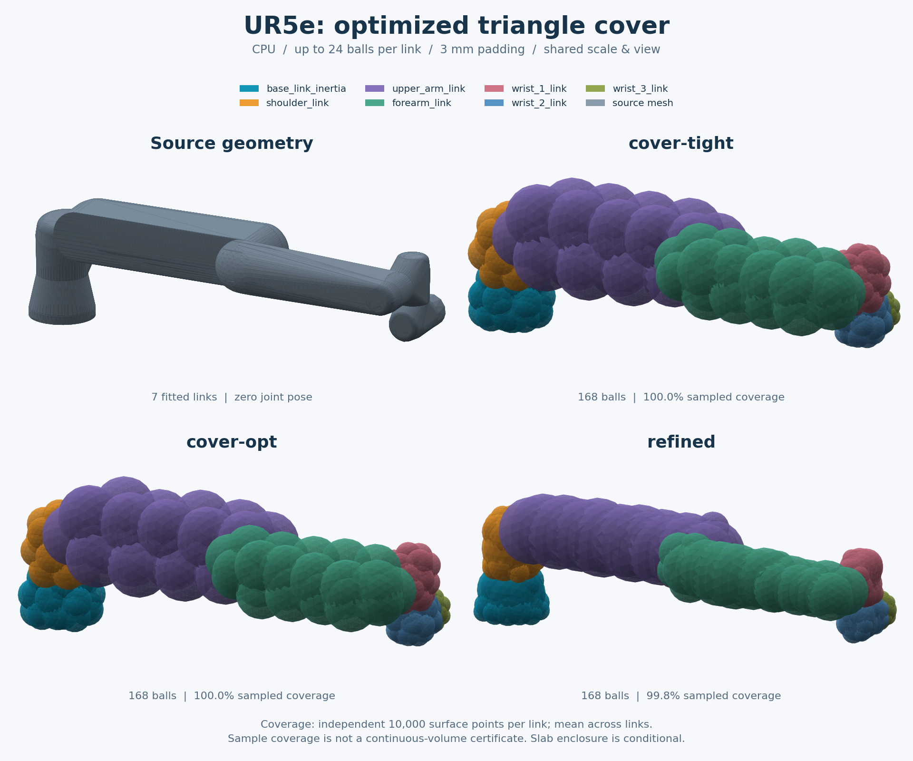

# 完整三角表面包络的进一步优化

`cover-opt` 从 `cover-tight` 开始，最多执行两轮完整三角形重分组和包围球缩紧。
只接受包含 padding 的球体积之和下降的结果，不增加球数、不增加依赖。
它改善的是表面包络；要求实体内部覆盖时，应另外检查 `slab` 的边界假设和外扩。

## UR5e 实际结果



输入为 7 个闭合 collision link，零关节位姿，每 link 上限 24 球、padding 3 mm、seed 0。
源模型及许可见[资产说明](third-party-assets.md)。[图中参数和球模型](ur5e-cover-opt.json)保存了
输入哈希、依赖版本及独立表面采样结果。

下表来自[独立基准记录](ur5e-cover-opt-benchmark.json)：CPU 串行，6000 个拟合/报告样本，
refined 使用 `refine_samples=2048`、120 步；每种方法共 168 球。
每 link 用共同的 10,000 个表面点和 50,000 个体积点评价，测试种子 77079 未用于拟合、
选择分组代价或迭代次数。共同采样域包含原网格和所有候选球。

| 方法 | 表面覆盖 | 实体覆盖 | 外扩 / 原 mesh 体积 | IoU | 拟合耗时 |
| --- | ---: | ---: | ---: | ---: | ---: |
| cover-tight | 100.00% | 97.45% | 1.654 | 0.372 | 0.621 s |
| cover-opt | 100.00% | 96.80% | 1.485 | 0.392 | 1.184 s |
| slab | 100.00% | 100.00% | 1.218 | 0.463 | 0.162 s |
| refined | 99.80% | 100.00% | 0.526 | 0.661 | 1.915 s |

质量列为逐 link 比例的算术平均，不是装配机械臂的体积比例。耗时为各 link 预热后三次
完整 `fit_mesh` 耗时中位数之和，含报告，不含加载、导出和独立评价；仅代表本次 CPU 环境。
实体指标是 `mesh.contains` 的 Monte Carlo 估计，未检查自交。每 link 有效内部点为
6316–7758 个；四舍五入后的 100.00% 也可能存在漏点，不能当作连续覆盖证明。

相对 cover-tight，cover-opt 的各 link 外扩估计均下降，球体积之和合计下降 **14.5%**。
但内部覆盖略降，耗时约增加 91%。在这组 UR5e 上，实体包络优先考虑 slab；
若允许有限采样优化的欠覆盖，refined 的实测外扩更小。cover-opt 适合需要完整三角表面包络、
并愿意付出额外时间来改善 cover-tight 的场景。

## 单轴切片并非总是更好

同一配置下，对盒子、圆柱、球和圆环进行了[独立对照](cover-opt-primitives-benchmark.json)。
例如圆环的外扩 / 原 mesh 体积依次为：cover-tight **2.429**、cover-opt **1.493**、
slab **7.812**、refined **0.704**。前三者构造完整三角表面包络，refined 的 100% 仅为采样结果。
圆环的同一截面内有分离的分支，slab 用一个球包住它们，会明显填入孔洞。

因此没有将 cover-opt 设为默认，也不按球体积之和宣称它优于其他全部方法。
球体积之和包含重叠；缩小它不保证外扩或内部覆盖同时改善。

## 使用与复现

```bash
assetspheres fit /path/to/ur5e/robot.urdf --geometry collision \
  --method cover-opt --count 24 --padding 0.003 -o outputs/ur5e-cover-opt
assetspheres view outputs/ur5e-cover-opt/spheres.json
```

从仓库根目录运行，UR5e URDF 和 mesh 需另行准备：

```bash
python -m pip install -e '.[quality,plots]'
python benchmarks/benchmark_algorithms.py \
  --input /path/to/ur5e/robot.urdf --geometry collision \
  --method cover-tight --method cover-opt --method slab --method refined \
  --samples 6000 --refine-samples 2048 --surface-samples 10000 \
  --volume-samples 50000 --evaluation-seed 77079 --repeats 3 \
  --output outputs/ur5e-cover-opt-benchmark.json

python examples/render_comparison.py \
  --input /path/to/ur5e/robot.urdf --geometry collision \
  --method cover-tight --method cover-opt --method refined \
  --title "UR5e: optimized triangle cover" --columns 2 --zoom 2.2 \
  --output outputs/ur5e-cover-opt.png
```

省略 benchmark 的 `--input` 和 `--geometry` 即运行四个合成形状，其他参数保持一致。
绘图表面检查沿用 seed 950071，与基准 seed 不同；拟合配置相同。

方案细节见[算法说明](algorithm.md#cover-opt重新分组的三角表面包络)。
分组与球拟合交替进行的研究背景见
[VSSA 原论文页面](https://www.microsoft.com/en-us/research/publication/variational-sphere-set-approximation-solid-objects/)；
本实现使用更简单的球体积代理目标，不是其外部体积积分或论文算法的完整复现。
