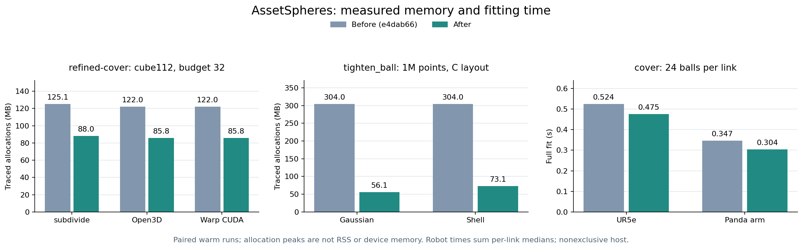

# 拟合内存与表面分组优化

这轮优化减少临时数组，并降低 `cover` 系列的质心更新开销。
方法、球预算和 padding 的含义沿用原有约定；测试中的球参数和报告均与基线一致。
[完整配对记录](fitting-performance.json)保留配置、源文件哈希、每次耗时和分配峰值。

## 改动

- **单位格点距离。** 使用 SciPy 返回的最近背景格点索引，逐轴累加平方距离，复用一份标量工作数组。
  不再同时保留各轴的全量浮点坐标差。采用同一最近背景变换和单位格距，
  不是用近似距离替代 EDT；接口依据见 [SciPy 文档](https://docs.scipy.org/doc/scipy/reference/generated/scipy.ndimage.distance_transform_edt.html)。
- **包围球缩紧。** 扩展精度检查、归一化和方向投影分块处理，投影按列存储以减少归约时的复制。
  所有原始点仍参与最终半径检查；归一化点集、索引和距离输出仍随输入规模线性增长。
- **表面质心。** 每个坐标统一聚合加权总和，保留逐组 NumPy 权重求和，避免改变分母的舍入顺序。
  空组保留原中心，非空零权重组仍报错。
- **几何准备。** 拟合副本不复制用不到的视觉和顶点属性；原资产继续供查看和导出使用。

没有增加拟合选项或核心依赖。CPU/CUDA 使用的体素准备与外部样本距离场均复用单位格点实现；
CUDA 优化器未作替换：尝试的直接距离反传和仅对选中球求梯度，都未在常用球数下稳定改善耗时。

## 实测

基线为 `e4dab66`，包围球与质心实现为 `7ab01cb`，距离场实现为 `d49a856`。
使用 AMD Ryzen 9 9950X、固定逻辑核 4、OpenBLAS/OMP 各 1 线程；主机未独占。
Python 3.10、NumPy 1.26.4、SciPy 1.15.3、Trimesh 4.12.2。
输入预先加载，每个案例先核对输出，再交替测量前后实现；内存另行测量，不与计时混用。



以下均为十进制 MB 的 **tracemalloc 分配峰值**，不是 RSS、原生运行时或显存：

| 约 140 万体素，32 球上限 | 候选准备：之前 → 之后 | 完整 refined-cover：之前 → 之后 |
| --- | ---: | ---: |
| subdivide / CPU | 112.1 → 83.7 | 125.1 → 88.0 |
| Open3D / CPU | 81.6 → 81.6 | 122.0 → 85.8 |
| Warp / CPU 或 CUDA | 81.6 → 81.6 | 122.0 → 85.8 |

完整 refined-cover 在这些案例中进一步降低约 **30%** 峰值。
Open3D / Warp 的候选准备没有用到 EDT，因而不在该阶段节省内存。
32 组小/大输入配对涵盖准备、voxel、refined 和 refined-cover，均核对完整输出。
它们共用当前报告与表面修补阶段，只替换基线的 voxel_fit.py 和 refine.py。

百万点的单次 `tighten_ball` 测量中，高斯点集峰值为 **304.0 → 56.1 MB**，
球壳点集为 **304.0 → 73.1 MB**，覆盖 C/F 两种布局；输入点集分配不计入。
小点集耗时基本持平。不要将单函数的峰值下降直接当作全部拟合流程的下降比例。

`cover` 的真实机械臂对照采用每 link 24 球、padding 3 mm、seed 0：

| 模型 | 完整拟合：之前 → 之后 | 耗时减少 |
| --- | ---: | ---: |
| UR5e，7 link | 0.524 → 0.475 s | 约 9% |
| Panda 手臂，8 link | 0.347 → 0.304 s | 约 12% |

时间为逐 link 预热后 7 次中位数之和，包含准备、拟合和报告，不含加载、导出。
完整记录还有 8/24/64 球预算、cover-tight / cover-opt / slab，以及两个高面数合成网格。
不是所有方法都有稳定提速，尤其不能将质心更新收益推广到 slab 或其他硬件。
高面数、多球分组的峰值也可能由分组或裁剪阶段决定。

## 验证与复现

主环境 **425 passed**；最低依赖 **353 passed / 41 skipped**；
Python 3.12、NumPy 2、Trimesh 5 环境 **367 passed / 36 skipped**。
仅安装核心依赖的独立 wheel 环境也通过 voxel、cover、refined-cover 的 CLI、导出和报告回读。
最终配对包含 16 个点集、204 个完整表面拟合、32 组体素准备/拟合和 2 个距离内核案例。
同一环境内的前后对照一致，不承诺跨库版本或跨设备逐位一致。

UR5e/Panda 的 CLI、五种格式导出、线程/进程结果、GLB 变换和查看器通过复核；
[已有图示](refined-cover.md)的参数一致，UR5e 六种已有方法也与此前保存的球参数一致。
另外重新检查了 295 个 collision link，包括 62 次开放网格的显式回退；
全部通过，非计时记录与此前结果一致。
这些检查不增加连续实体覆盖或运动规划保证。

在当前仓库根目录运行，第三方资产的准备见[来源说明](third-party-assets.md)：

```bash
git worktree add --detach /tmp/assetspheres-performance-reference e4dab66
ASSETSPHERES_REFERENCE=/tmp/assetspheres-performance-reference/src/assetspheres

OPENBLAS_NUM_THREADS=1 OMP_NUM_THREADS=1 \
python benchmarks/benchmark_enclosing_memory.py --reference "$ASSETSPHERES_REFERENCE" \
  --points 1000 --points 32769 --points 100000 --points 1000000 \
  --repeats 9 --output outputs/enclosing-memory.json

OPENBLAS_NUM_THREADS=1 OMP_NUM_THREADS=1 \
python benchmarks/benchmark_enclosing_memory.py --reference "$ASSETSPHERES_REFERENCE" \
  --input /path/to/ur5e/robot.urdf --count 8 --count 24 --count 64 \
  --repeats 7 --output outputs/cover-performance.json

OPENBLAS_NUM_THREADS=1 OMP_NUM_THREADS=1 \
python benchmarks/benchmark_voxel_memory.py \
  --reference "$ASSETSPHERES_REFERENCE/voxel_fit.py" \
  --reference-refine "$ASSETSPHERES_REFERENCE/refine.py" \
  --backend subdivide --full-fit --repeats 7 --output outputs/grid-memory.json
```

替换输入为 Panda 的 arm.urdf 可复现另一组手臂；合成网格用 `--dense` 替代输入，球数改为 1/24/64。
安装相应 extra 后，体素配对可追加 `--backend open3d --backend warp --warp-cuda`。
距离内核对照包含在 `python benchmarks/benchmark_hotpaths.py --repeats 9` 中。
本机还固定 CPU affinity；在其他主机上应选择可用逻辑核，并以实际测量为准。

图表读取本页发布的 JSON，不重新生成测量结果：

```bash
python -m pip install -e '.[plots]'
python examples/render_performance.py
```
