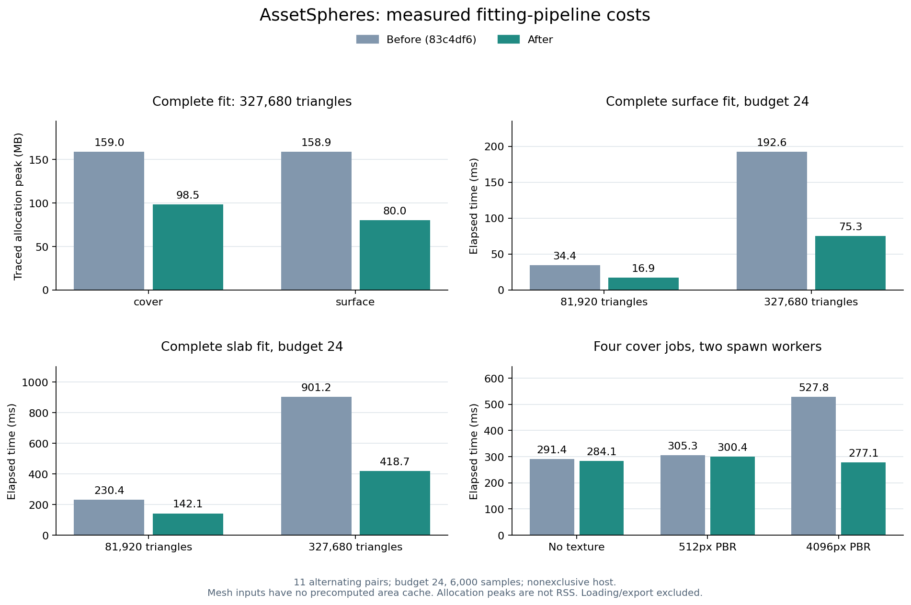

# 拟合流水线与分层去重

这轮优化复用拟合副本的几何缓存，减少闭合性报告的临时数组，加快分层点去重，并缩小进程任务。
拟合方法、球预算、采样种子和结果格式沿用原有约定；没有增加核心依赖或配置项。
[完整配对记录](fitting-pipeline.json)保留每次耗时、输入状态、库版本、源码哈希和完整结果指纹。

## 实现

- **面积只在副本上计算。** 顶点有限性仍先检查；面积验证与退化面清理共用独立副本的三角形缓存。
  没有预计算面积的源网格不再额外保留整份三角形、叉积和面积缓存。
- **闭合性报告。** 对普通 Trimesh，把无向边的两个索引编码为 64 位整数，排序后检查每条边恰好出现两次。
  重复四次也判为不闭合，不能仅检查计数为偶数。空网格、空面、负索引、超出编码范围和自定义子类沿用原判断。
  这用于 surface/cover 系列的报告；slab 复用该判定并让质量报告沿用结果，体积方法继续使用已有的原生拓扑缓存。
- **分层点去重。** 对较大的有限 float64 点集，用列排序和分块相邻行比较替代结构化浮点行排序。
  去重后的行顺序、代表点位模式和完整拟合结果与 `np.unique(axis=0)` 一致。
  小输入、非有限值及等价行含不同位模式等情况回退原路径；临时行比较按块分配。
- **进程任务。** 普通 Trimesh 只传顶点、面索引和 metadata，排除视觉、自定义属性和运行时缓存。
  父进程持有数组引用，序列化前不额外复制几何；worker 保持索引顺序，再按原流程清理独立副本。
  自定义网格子类沿用原对象路径，保留 `copy()` 等行为。metadata 仍随任务传递。

线程、单 worker、link 顺序和 CUDA 单所有者约束保持一致；进程池仍使用 spawn，每次调用独立管理生命周期。
闭合性与 Trimesh 的边计数判据一致，不增加朝向、自交或实体内部覆盖保证。

## 配对实测

基线 `83c4df6`，实现 `276bc4c`；AMD Ryzen 9 9950X、Python 3.10.0、
NumPy 1.26.4、SciPy 1.15.3、Trimesh 4.12.2。固定逻辑核，OpenBLAS/OMP 各 1 线程，主机未独占。
采用 11 次交替配对中位数，输出必须完全一致；加载、输入恢复和导出不计入拟合时间。



下表为约 33 万面的合成球网格、24 球预算、6,000 个评价样本的**完整 fit_mesh**。
“无面积缓存”指 Trimesh 的输入状态，不是冷启动解释器或清空 CPU/文件缓存。
MB 使用十进制，峰值由 **tracemalloc** 跟踪，不是 RSS、Pillow 原生像素内存或显存。

| 输入状态 / 方法 | 耗时：之前 → 之后 | 分配峰值：之前 → 之后 |
| --- | ---: | ---: |
| 无面积缓存 / cover | 0.771 → 0.634 s | 159.0 → 98.5 MB |
| 已有面积缓存 / cover | 0.711 → 0.642 s | 125.0 → 98.5 MB |
| 无面积缓存 / surface | 0.193 → 0.075 s | 158.9 → 80.0 MB |
| 已有面积缓存 / surface | 0.143 → 0.072 s | 124.8 → 80.0 MB |
| 无面积缓存 / slab | 0.901 → 0.419 s | 159.9 → 125.8 MB |
| 已有面积缓存 / slab | 0.778 → 0.400 s | 125.8 → 125.8 MB |

同一网格的单次准备峰值为 **114.0 → 80.0 MB**；已有面积缓存时，准备阶段峰值基本不变。
大网格的完整 `slab` 拟合耗时减少约 **54%**，已有面积缓存时，其分配峰值基本不变。
小网格的完整拟合耗时也基本持平，不能把大输入的收益推广到所有配置。

进程案例使用 `cover`、4 个网格任务、每任务 24 球、6,000 个评价样本、2 个 worker。
每次在新父进程中测量，包含派发、spawn、worker 导入、拟合、报告和关闭池；父进程导入与输入准备在计时外。

| 输入 | 完整进程调用：之前 → 之后 | 提交任务的序列化估计：之前 → 之后 |
| --- | ---: | ---: |
| 无纹理 | 0.291 → 0.284 s | 0.052 → 0.049 MB |
| 已预计算几何缓存 | 0.346 → 0.368 s | 6.562 → 0.741 MB |
| 自定义顶点属性 | 0.352 → 0.328 s | 5.990 → 0.741 MB |
| 512 × 512 RGBA / PBR | 0.305 → 0.300 s | 4.257 → 0.049 MB |
| 4096 × 4096 RGBA / PBR | 0.528 → 0.277 s | 268.498 → 0.049 MB |

序列化估计来自实际提交的任务对象，不包含函数、消息封装或传输层开销，也不是进程内存峰值。
大纹理案例的完整调用耗时减少约 **47%**；小任务仍主要受进程启动成本影响。

真实机械臂同样采用 `cover`、24 球/link、6,000 个评价样本、2 个进程，几何加载在计时外：

| 输入 | 完整 fit_asset：之前 → 之后 | 配对耗时变化中位数 |
| --- | ---: | ---: |
| UR5e collision | 0.466 → 0.488 s | +0.7% |
| UR5e visual | 0.457 → 0.451 s | −2.6% |
| Panda 手臂 collision | 0.426 → 0.427 s | −0.3% |
| Panda 手臂 visual | 0.516 → 0.494 s | −6.4% |

主机未独占，两个独立中位数之差可能与逐对变化中位数方向不同；
配对变化逐次计算 `(之后 / 之前 − 1)`，负值表示更快。机械臂没有稳定的大幅提速，包含略慢的案例。
球参数、报告和 link 顺序逐项相同。
输入来源和许可见[第三方资产说明](third-party-assets.md)，仓库不附带这些 URDF 或 mesh。

## 验证与复现

主环境 **496 passed**；最低依赖 **423 passed / 42 skipped**；
Python 3.12、NumPy 2、Trimesh 5 环境 **438 passed / 36 skipped**。
新增测试覆盖忽略不可序列化的视觉/属性、子类复制行为、metadata 错误、非法几何、边计数反例，
以及分层去重的带符号零、次正规数和分块边界。
120 组准备对照含 40 组一致的拒绝结果，115 次完整拟合对照相同。
另对 UR5e、Panda、G1、R1、T1 的 collision/visual 共 215 份 link 几何完成 1,290 次完整拟合对照，
涵盖 surface/cover/voxel 和三种球预算的 slab；20 批次串行/进程整资产结果一致。
UR5e/Panda 的 CLI、五种导出、线程/进程结果、GLB 变换及查看器 HTTP 通过复核，已有图示参数保持一致。
仅安装核心依赖的独立 wheel 也通过四种方法的 spawn 拟合、导出和报告回读。
线程/进程各 20 次正常及 20 次失败调用后，源网格、纹理、metadata 和属性数组均可回收。

准备脚本按独立包名加载基线及其方法实现。在仓库根目录运行：

```bash
git worktree add --detach /tmp/assetspheres-pipeline-reference 83c4df6
ASSETSPHERES_REFERENCE=/tmp/assetspheres-pipeline-reference/src/assetspheres
python -m pip install -e '.[plots]'

OPENBLAS_NUM_THREADS=1 OMP_NUM_THREADS=1 \
python benchmarks/benchmark_preparation.py --reference "$ASSETSPHERES_REFERENCE/fit.py" \
  --full-fit --method cover --repeats 11 --output outputs/preparation-cover.json

OPENBLAS_NUM_THREADS=1 OMP_NUM_THREADS=1 \
python benchmarks/benchmark_preparation.py --reference "$ASSETSPHERES_REFERENCE/fit.py" \
  --full-fit --method surface --repeats 11 --output outputs/preparation-surface.json

OPENBLAS_NUM_THREADS=1 OMP_NUM_THREADS=1 \
python benchmarks/benchmark_preparation.py --reference "$ASSETSPHERES_REFERENCE/fit.py" \
  --full-fit --method slab --repeats 11 --output outputs/preparation-slab.json

OPENBLAS_NUM_THREADS=1 OMP_NUM_THREADS=1 \
python benchmarks/benchmark_process_transport.py --reference "$ASSETSPHERES_REFERENCE" \
  --repeats 11 --output outputs/process-transport.json

OPENBLAS_NUM_THREADS=1 OMP_NUM_THREADS=1 \
python benchmarks/benchmark_process_transport.py --reference "$ASSETSPHERES_REFERENCE" \
  --case robot --input /path/to/ur5e/robot.urdf --geometry collision \
  --repeats 11 --output outputs/ur5e-process.json

python examples/render_pipeline_performance.py
```

图表读取发布的 JSON，不重新测量。本机 cover/surface/slab 分别固定到逻辑核 4/5/6，进程案例限制到核 8–11。
其他机器应选择可用核并以实际数据为准；此前的[拟合内存](fitting-performance.md)和[启动/预览](startup-and-preview.md)记录单独保留。
