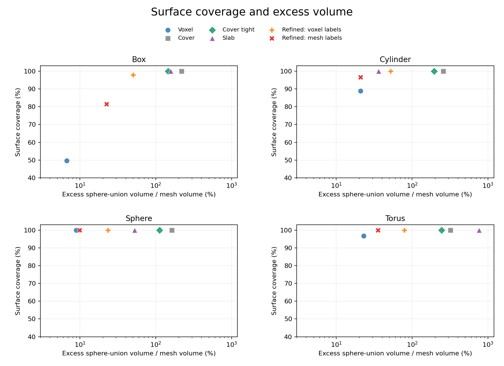

# CPU / CUDA 与生成算法实验

这是 v0.2 的历史实验记录。v0.3 已新增可选的原 mesh 距离后端与易用 CLI，见 [voxelizer-performance.md](voxelizer-performance.md)；下面“尚未实现”的描述以 v0.2 当时状态为准。

日期：2026-11-03。结论基于本机实测，尚不是跨硬件的性能保证。完整原始记录位于本地 `outputs/benchmark-{parallel,tensor,algorithms}.json`；仓库保留了去掉源资产路径的[实验快照](benchmarks-2026-11-03.json)和可复现脚本。

## 当前建议

- 批量 CPU link：保持默认串行；明确需要并行时，先尝试 4 线程。短任务不宜为每次拟合新建进程池。
- 已经在 GPU 上批量做距离评价或优化：可选 CUDA。一次性的小资产球化仍适合 CPU；当前体素化并未移到 GPU。
- 细长 link 且需要完整包络：优先实验 `slab`。它在长圆柱上比原 `cover` 更快、更贴合，但会桥接截面上的多个分支和孔洞。
- 保留原通用三角表面分组：`cover-tight` 缩小每簇包围球，保留表面覆盖；它仍可能漏掉实体中心。
- 追求表面覆盖与外扩的可调折中：试 `refined`，同时检查体积指标。它不是所有形状都优于 `voxel`，所以本轮没有将其设为默认。

## 测量设置

CPU 为 AMD Ryzen 9 9950X（16 核、32 线程），GPU 为 RTX 5090 D v2（24 GB），PyTorch 2.8.0+cu128，NumPy 1.26.4，SciPy 1.15.3，trimesh 4.12.2。桌面和另一 GPU 程序仍在运行，未进行独占 GPU 或操作系统隔离；绝对时间存在运行间波动。

CPU 并行取 3 次完整调用的中位数，包含线程/进程池启动与关闭、spawn 导入、传输、拟合和已有质量报告；不含源文件读取和资产导出。每次从同一输入快照恢复，避免只让后测方法享受 mesh 缓存。所有执行模式的球参数与 link 顺序通过精确比较。

CUDA 阶段计时包括 NumPy → device → NumPy 的传输，使用同步后的墙钟时间。另有独立子进程冷启动和完整 `fit_mesh` 测量；单独的点球距离倍数不被当作完整球化倍数。Tensor CPU 的 dense 贪心在实测中远慢于现有 SciPy lazy 贪心，因此没有替换 CPU 默认实现。

## CPU 按 link 并行

| 工作负载 | 串行 | 4 线程 | 4 个 spawn 进程 |
| --- | ---: | ---: | ---: |
| 4 个微小 surface 任务 | 2.16 ms | 3.94 ms | 503 ms |
| 16 个 box，voxel/res80 | 4.909 s | 2.533 s | 2.433 s |
| UR10，7 links，cover32 | 0.737 s | 0.254 s | 0.703 s |

UR10 的 4 线程约为串行的 2.91 倍；16 个体素任务则约为 1.94 倍。Python GIL 并不意味着此处线程必然无效：NumPy / SciPy / trimesh 的部分数组操作在原生代码中执行，可以重叠。进程有更多隔离和序列化成本，只有足够大的工作负载才能摊薄。

这只是按 link 的独立任务并行，不是多线程共同修改同一份 mesh。进程使用 spawn，避免从已初始化 CUDA 的父进程 fork。CUDA 执行保持单个 GPU owner，不允许多个完整 link worker 分别争用同一设备。

## CUDA：阶段加速与完整拟合分开看

准确的冷热时间及样本尺寸见[实验快照](benchmarks-2026-11-03.json)。本轮的量级是：

- 6,000 点 × 32 球的距离评价：NumPy 约 5 ms，CUDA 约 0.2～0.6 ms。
- 50,000 点 × 128 球：NumPy 约 0.15 s，CUDA 约 1～2 ms。
- 6,000 点 × 768 候选、选 32 球的 greedy：SciPy 约 6 ms，CUDA 约 3 ms。
- 完整体素拟合在 res24 box 上没有稳定的 GPU 优势；res80 box 也只有有限收益。冷进程 CUDA 通常还要支付约 1～2 秒的框架与运行时准备成本。

使用 float64 是为了减少球边界包含判断的精度差异。GPU 的 candidate tie 按最小候选下标处理，CPU lazy heap 同步采用相同规则；两种 box 完整拟合的 CPU/CUDA 球参数在本机逐项相同。

最终复测的完整 box 数据如下，均包含拟合内的报告计算：

| 工作负载 | CPU 热运行 | CUDA 热运行 | CPU 冷进程 | CUDA 冷进程 |
| --- | ---: | ---: | ---: | ---: |
| res24，16 球 | 59.1 ms | 49.3 ms | 446 ms | 1,795 ms |
| res80，32 球 | 367 ms | 288 ms | 699 ms | 1,932 ms |

这轮热运行约为 1.20～1.28 倍，远低于距离阶段的倍数；小负载的运行间波动还能抵消这点收益。

候选覆盖矩阵设置工作内存预算，包含 bool/int64 归约的临时转换；超预算时分块重算相同目标，不改变算法。该预算不包括线性输入/输出、PyTorch 上下文、allocator 和其他进程，并非总显存上限。

## profile：当前优先优化体素化

单次 cProfile 显示：

| 预加载输入 | 完整 fit | trimesh 体素化 | 点球评价 | EDT |
| --- | ---: | ---: | ---: | ---: |
| 0.2 m box，res80 / 32 球 | 353 ms | 217 ms | 55 ms | 32 ms |
| 半径 0.05 m、长 0.3 m 的圆柱，res48 / 32 球 | 561 ms | 547 ms | 数 ms | 小于主要体素化开销 |

当前 `voxelized(subdivide)` 为覆盖大三角形而反复细分，圆柱的长边三角形尤其明显。即使后面的距离核无限快，也无法消除该阶段。仅把 EDT 换成 GPU 也不足以解决圆柱瓶颈。

下一轮更值得比较的是 BVH / 光栅或射线占据查询、Warp 的 GPU mesh 距离查询，以及带表面遗漏验证的体素化替代。trimesh 的现有 ray voxelizer 主要沿 Z 射线采集命中点，不能未经检查就替换原流程：近乎平行的薄面、小结构和填充语义可能不同。[CuPy 官方 EDT](https://docs.cupy.dev/en/stable/reference/generated/cupyx.scipy.ndimage.distance_transform_edt.html)提供另一阶段的 GPU 选项，但本轮没有把未实测方案写成已实现加速。

CPU/GPU 真正重叠的后续流水线应是：

```text
CPU 有界 worker：读取 / 校验 / mesh 或栅格准备
                   ↓ 有界队列，控制内存
单 GPU executor：批量 SDF / 候选收益 / 球优化 / 大批量评价
                   ↓
CPU：验证报告与各格式导出
```

当前 `--workers` 是完整 CPU link 并行，`--device cuda` 是同一 link 流程内使用 GPU 阶段；上述异步队列和批量 GPU SDF 尚未实现。应优先解决 profile 中的主要瓶颈，再判断异步重叠是否值得其复杂度。

## 算法质量：同预算、同 padding、独立评价

所有方法最大预算为每个形状 24 球，padding 3 mm，resolution 48。原有体素和优化方法可以少于预算，例如近球形物体可能只生成一个球；报告保留实际球数。`refined` 使用 120 次 Adam，每组最多 1,024 训练点，outside 权重 10。

先以种子 73001 做探索，冻结本轮实现和参数后，另用种子 88003 做最终确认；下表和快照采用确认结果。评价使用同一批 6,000 个独立表面点和 20,000 个均匀体积点，与训练种子分离。每个形状的所有方法共用一个包含全部球及原 mesh 的评价域。体积内外参考为原三角 mesh 的 `contains`；这四个测试形状都是单个闭合表面，仍假设没有自交。

外扩定义为 **球并集在原 mesh 外的体积 / 原 mesh 体积**，不含重叠重复计数，数值可超过 100%。这些体积数值均为 Monte Carlo 估计；实际有效内部样本数随形状和公共评价域变化，保存在快照中。

| 圆柱方法 | 表面覆盖 | 实体覆盖 | 外扩/原体积 | IoU | 热拟合 |
| --- | ---: | ---: | ---: | ---: | ---: |
| voxel | 88.8% | 99.1% | 20.8% | 0.820 | 1,321 ms |
| cover | 100% | 100% | 258.6% | 0.279 | 68.5 ms |
| cover-tight | 100% | 100% | 194.4% | 0.340 | 107 ms |
| slab | 100% | 100% | 36.2% | 0.734 | 14.9 ms |
| refined，体素标签 | 100% | 100% | 52.2% | 0.657 | 840 ms |
| refined，原 mesh 标签 | 96.7% | 99.9% | 20.9% | 0.826 | 714 ms |

该工作站没有隔离其他负载：圆柱 voxel 在探索轮约 498 ms，确认轮约 1,321 ms，其他方法也有波动。表中保留确认轮的完整时间，不根据快慢挑选某次运行；不能据此推断增加优化阶段本身会加速 CPU 体素化。原始逐次时间可用于复核。

圆柱上 `slab` 是本轮最有价值的保守包络改进：相对原 `cover`，生成更快，外扩显著降低，并且有明确的实体包络几何前提。但 `voxel` 的 IoU 仍更高，只是表面有缝隙；不能用一个数抹平这两种用途。

反例同样重要：torus 的 `slab` 外扩约 764%，IoU 仅 0.116，因为切片球把环形横截面的空洞和分支一起包住。近球形资产上，原 `voxel` 的 IoU 约 0.918，优于体素标签 `refined` 的约 0.810。提高覆盖率并不是全面提高拟合质量。

`cover-tight` 在四个形状中都缩小了球体积和，且本轮外扩估计也下降；其一般保证只是逐簇半径不增加和三角表面覆盖保留。Box 的表面为 100% 时，内部仍可能略有遗漏；sphere 的旧 `cover` 内部覆盖约 91%，直观说明了“完整表面包络”和“完整实体包络”的区别。

原 mesh 标签能减轻体素边界偏差，但不会免费获得全部优点。例如 box 的表面覆盖从体素标签 refined 的约 98% 降至约 82%，同时外扩从约 50% 降至约 22%。这些参数没有依据最终确认集选择；若下一轮调权，应另留新的测试种子。



## 下一轮算法探索优先级

1. 对细长机器人 link 比较 `slab`、中心轴/胶囊链和现有体素候选；先做任务明确的形状选择，避免把 `slab` 用到空腔或多分支横截面。
2. 用覆盖遗漏、外扩误差驱动球的重新分布、split/merge，仍保持预算；不要把预算都浪费在已覆盖区域。
3. 减少体素化细分，比较更可靠且可批量化的原 mesh SDF / 占据查询，再考虑 CPU producer + 单 GPU executor 流水线。
4. 与 [MorphIt 作者算法](https://github.com/HIRO-group/MorphIt-1)做独立基线对照；当前 `refined` 仅受其优化思路启发，不是论文复现。中轴 / MSS 与球树的来源、用途和依赖条款见 [research-algorithms.md](research-algorithms.md)。

## 复现

```bash
python -m pip install -e '.[dev,quality,plots]'

# 默认使用自生成资产；可另外传 --urdf /path/to/robot.urdf
python benchmarks/benchmark_parallel.py --repeats 3

# 需要已经可运行 CUDA 的 PyTorch；包含冷进程、热阶段和完整拟合
python benchmarks/benchmark_tensor.py --full-fit --repeat 5 \
  --output outputs/benchmark-tensor.json

python benchmarks/benchmark_algorithms.py \
  --cuda --mesh-reference --repeats 3 --output outputs/benchmark-algorithms.json
```

研究与实验不证明原生 Lula、cuRobo 或 RMPflow 运行中的实际碰撞性能。下游规划还需要检查自碰撞对、最小通道间隙和接触任务对外扩的容忍度。
