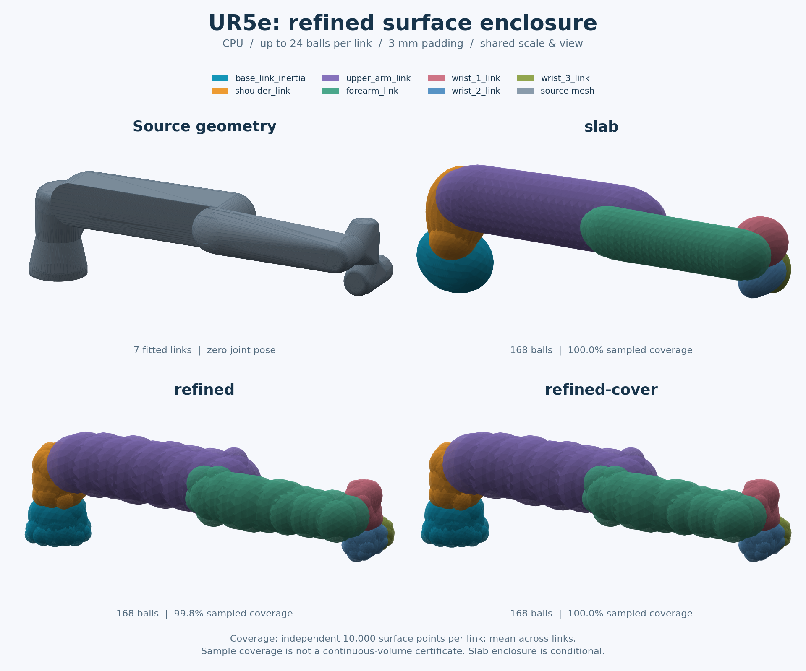
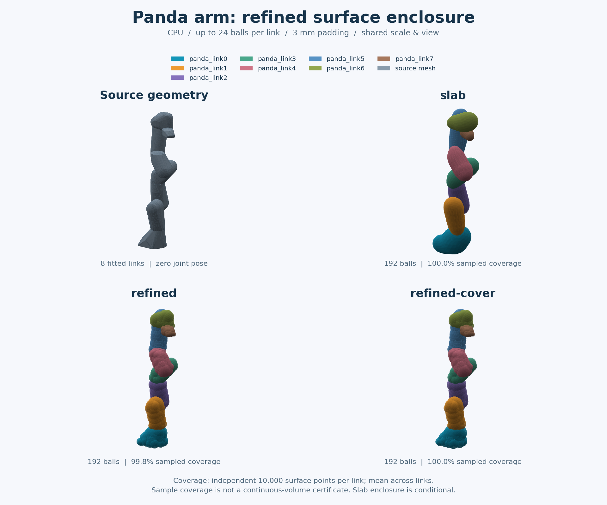

# 优化后的三角表面修补

`refined-cover` 先执行现有 `refined` 优化，再把未能确认覆盖的三角形自适应细分，仅扩大必要的球。
它不增加球数、不移动球心、不重复添加 padding，原球集已经覆盖的点仍被覆盖。
相对原 `refined`，外扩只会不变或增加；它的用途是把较贴合的采样近似变成三角表面包络，
不是证明实体内部覆盖。

```bash
assetspheres fit /path/to/robot.urdf --geometry collision \
  --method refined-cover --count 24 --padding 0.003 -o outputs/repaired
assetspheres report outputs/repaired/spheres.json
assetspheres view outputs/repaired/spheres.json
```

## UR5e 与 Panda 实际结果



UR5e 的 7 个 collision link 均为闭合单壳，每 link 上限 24 球，共 168 球；padding 3 mm、seed 0。
下表使用两组独立测试种子的逐 link 比例算术平均；耗时为各 link 预热后 5 次测量的中位数之和，
再对两轮取平均。

| 方法 | 表面覆盖 | 实体覆盖 | 外扩 / 原 mesh 体积 | IoU | 完整拟合 |
| --- | ---: | ---: | ---: | ---: | ---: |
| cover-opt | 100.00% | 96.79% | 1.458 | 0.396 | 1.42 s |
| slab | 100.00% | 100.00% | 1.206 | 0.466 | 0.22 s |
| refined | 99.80% | 99.99% | 0.515 | 0.666 | 2.42 s |
| refined-cover | 100.00% | 100.00% | 0.555 | 0.647 | 2.43 s |
| refined-cover，mesh 监督 | 100.00% | 100.00% | 0.502 | 0.671 | 2.54 s |

相对 cover-opt，默认 refined-cover 的外扩估计减少约 **62%**，代价是更长的拟合时间。
相对 refined，它补齐了表面包络，但外扩增加约 **8%**。实体覆盖优先且希望更快时，
可考虑 slab 的有界实体边界假设；本次未见内部漏点不代表通用连续实体覆盖证明。

<details>
<summary>Panda 手臂的同预算结果</summary>



Panda 手臂有 8 个带 collision 几何的 link，不含手爪；每 link 24 球，共 192 球。
其他配置相同。cover-opt、slab、refined、refined-cover 的平均外扩比例分别为
**1.337、0.993、0.427、0.458**；mesh 监督的 refined-cover 为 **0.372**。
默认修补相对 cover-opt 减少约 66% 外扩；相对未修补 refined 增加约 7%。

</details>

图示只采用关节零位，展示碰撞几何近似，不进行关节限位、运动或硬件验证。
[UR5e 图中参数与球模型](ur5e-refined-cover.json)、[Panda 图中参数与球模型](panda-refined-cover.json)
包含输入及加载后网格哈希、版本和独立表面检查；[模型来源与许可](third-party-assets.md)另行列明。

### 测量口径

[完整原始对照](refined-cover-benchmarks.json)同时包含两种机器人和盒子、圆柱、球、圆环，
以及未修补的 mesh 监督结果。所有方法每 link 使用同一批 **20,000 个表面点、200,000 个体积点**，
共同采样域包含原 mesh 和全部候选球。测试种子 **251003、251017** 未用于选择修补规则或参数。
图示另用 10,000 个表面点、seed 950071，拟合配置一致。

拟合配置为 resolution 48、samples 6000、refine_samples 2048、iterations 120、outside_weight 10。
CPU 为 AMD Ryzen 9 9950X，限定到同一逻辑核，OpenBLAS/OMP 各 1 线程；
完整 fit_mesh 包含准备、优化、修补和报告，
不含加载、导出或独立评价。主环境为 Python 3.10、NumPy 1.26.4、SciPy 1.15.3、Trimesh 4.12.2。
主机未独占，绝对耗时会波动。

表中不是装配机械臂整体的体积比例。体积指标是基于原三角 mesh.contains 的 Monte Carlo 估计，
没有自交检测；舍入后的 100.00% 也不能当作连续覆盖证明。球体积之和包含重叠，不用它替代外扩指标。

## 已有选项比增加迭代更值得先检查

在本次单闭合壳数据上，显式采用原网格监督能进一步减少修补后的外扩：
UR5e 的 **0.555 → 0.502**，Panda 的 **0.458 → 0.372**。
它需要 quality extra 和单个闭合、无自交的表面体假设，不会按安装情况自动更换默认方法。

```bash
python -m pip install -e '.[quality]'
assetspheres fit /path/to/robot.urdf --geometry collision \
  --method refined-cover --refine-reference mesh --count 24 --padding 0.003 \
  -o outputs/mesh-supervised
```

开发实验中，将体素监督从 120 步加到 240 步，平均外扩改善不足 1%，耗时明显增加。
固定 168 球的逐 link 重分配在开发数据上预计减少 4.5% 外扩，但独立测试仅减少约 1.0%–1.2%，
还会恶化手腕局部比例，因此没有加入固定预设。自适应切片、PCA 轴筛选也仅保留为实验，
避免为部分形状的收益增加默认流程的成本和复杂度。

## 完整 CUDA 拟合

[CPU/CUDA 对照](refined-cover-cuda.json)使用本机 RTX 5090 D v2、PyTorch 2.8.0，
保留 CPU 体素准备和表面修补。下表为 refined-cover 的热运行时间，同一行球预算相同：

| 每 link 球上限 | UR5e：CPU → CUDA | Panda 手臂：CPU → CUDA |
| --- | ---: | ---: |
| 24 | 2.59 → 2.36 s | 2.07 → 1.81 s |
| 64 | 3.31 → 2.42 s | 2.78 → 1.88 s |
| 128 | 4.49 → 2.66 s | 3.97 → 1.94 s |

这是各 link 完整 fit_mesh 预热后 5 次中位数之和，CPU 固定一个逻辑核，OpenBLAS/OMP 各 1 线程。
CUDA 上下文已经可复用；第一次 Torch/CUDA 初始化还会增加开销，小预算和一次性任务不一定受益。
设备未独占，不把本次倍数推广到其他硬件；CPU/CUDA 都使用 float64，但不承诺跨设备球参数逐位相同。
这些结果只比较已选定球预算下的生成时间，不建议为了获得加速而增加下游碰撞查询的球数。

```bash
python benchmarks/benchmark_algorithms.py \
  --input /path/to/ur5e/robot.urdf --geometry collision \
  --method refined --method refined-cover --cuda --count 128 \
  --samples 6000 --refine-samples 2048 --surface-samples 20000 \
  --volume-samples 200000 --evaluation-seed 251003 --repeats 5 \
  --output outputs/ur5e-cuda.json
```

## 内存与数值边界

大体素点集分批转换坐标，先释放栅格工作数组再生成点云；外部训练样本按点块写入占据栅格，
不再保留完整点索引数组到 EDT 结束。保留 Trimesh 原有的近单位矩阵语义、采样顺序和随机数消耗。
修补距离先归约顶点平方距离再开方，减少临时数组；大块距离内核配对测量约快 1.5–1.9 倍，
不能将其直接解释为完整拟合加速。

约 140 万体素的 cube112 配对结果如下，单位为十进制 MB：

| 路径 | 候选准备峰值：之前 → 之后 | 完整 refined-cover 峰值：之前 → 之后 |
| --- | ---: | ---: |
| subdivide / CPU | 163.1 → 112.1 | 171.3 → 125.1 |
| Open3D / CPU | 170.7 → 81.6 | 170.7 → 122.0 |
| Warp / CPU 或 CUDA | 170.7 → 81.6 | 170.7 → 122.0 |

这是 tracemalloc 跟踪的分配峰值，不是进程 RSS、原生运行时或显存峰值。
候选准备下降约 31%–52%，完整 refined-cover 下降约 27%–29%。
[32 组配对记录](refined-cover-memory.json)包含小/大输入、首次预热后的耗时和完整输出一致性；
耗时存在波动，不宣称所有路径全面加速。

修补使用归一化 float64 坐标、尺度/源坐标 ULP 裕量和向外舍入，不是区间算术。
最大深度 8、最多 100,000 次细分；达到预算时包住剩余粗三角形，可能增加外扩，不丢弃区域。
报告保留粗叶数量、增长球数和最大半径增量。具体构造见
[算法说明](algorithm.md#refined-cover保留优化结果构造三角表面包络)。

## 复现

从仓库根目录运行；第三方 URDF 和 mesh 需自行准备，仓库不附带这些源资产。

```bash
python -m pip install -e '.[plots,quality]'
python benchmarks/benchmark_algorithms.py \
  --input /path/to/ur5e/robot.urdf --geometry collision \
  --method cover-opt --method slab --method refined --method refined-cover \
  --mesh-reference --count 24 --samples 6000 --refine-samples 2048 \
  --surface-samples 20000 --volume-samples 200000 --evaluation-seed 251003 \
  --repeats 5 --output outputs/ur5e-final.json

python examples/render_comparison.py \
  --input /path/to/ur5e/robot.urdf --geometry collision \
  --method slab --method refined --method refined-cover \
  --title "UR5e: refined surface enclosure" --columns 2 --zoom 2.2 \
  --output outputs/ur5e-refined-cover.png

python benchmarks/validate_surface_cover.py --cases 500 \
  --output outputs/surface-cover-validation.json
```

将评价种子改为 251017 可运行另一轮；替换输入为 Panda arm.urdf 即运行手臂对照，绘图使用
`--title "Panda arm: refined surface enclosure" --zoom 1.1`。省略输入则对照四个合成形状。

开发阶段的 [684 个案例记录](refined-cover-study.json)固定在初始几何实现 80c0bf3，覆盖
6 种球预算、3 个拟合种子及 0/3 mm padding；后续内存/距离优化另行核对结果一致。
[验证摘要](refined-cover-validation.json)还记录了每套环境各 500 个原坐标扩展精度检查、
另外 295 个实际 collision link，以及开放 mesh 的显式失败和 62 次 cover 回退。
这些检查不替代构造论证，也不包括实际接触或规划验证。

<details>
<summary>复现内存配对</summary>

基线比较 voxel_fit.py 和 refine.py，报告及表面修补阶段在两条路径中共用当前实现：

```bash
git worktree add --detach /tmp/assetspheres-memory-reference 80c0bf3
OPENBLAS_NUM_THREADS=1 OMP_NUM_THREADS=1 python benchmarks/benchmark_voxel_memory.py \
  --reference /tmp/assetspheres-memory-reference/src/assetspheres/voxel_fit.py \
  --reference-refine /tmp/assetspheres-memory-reference/src/assetspheres/refine.py \
  --backend subdivide --backend open3d --backend warp --warp-cuda \
  --full-fit --repeats 7 --output outputs/voxel-memory.json
```

可选后端须分别安装对应 extra；只检查核心 CPU 路径时保留 `--backend subdivide`，
省略其他 backend 和 `--warp-cuda`。

</details>
