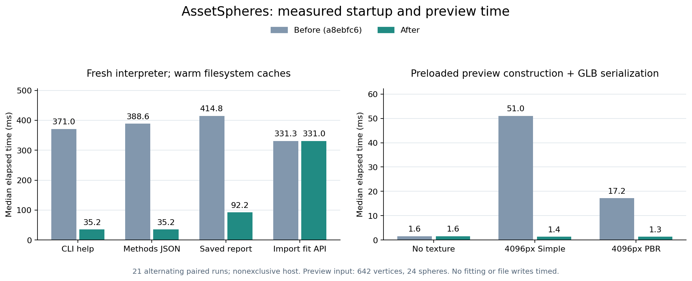

# CLI 启动与预览导出

这轮优化减少查询命令的依赖加载，以及预览中随即被替换的材质复制。
没有增加配置或核心依赖；拟合算法、球参数、命令输出及导出格式沿用原有约定。
[配对记录](startup-and-preview.json)包含所有测例、每次耗时、环境及源码哈希。

## 实现

- 包级 API 首次访问时才导入所属模块，随后缓存原始对象；保留公开名称、子模块访问和 pickle 路径。
- CLI 在具体命令中加载后端。帮助、版本、方法列表和参数解析错误不再加载 NumPy、Trimesh 或 SciPy。
- 已保存结果的读取独立于几何和导出模块，`report` 不需要加载源模型。
  原有的 `assetspheres.export.read_result` 入口保留，非有限 JSON 数值和 schema 检查保持一致。
- GLB 预览原本就将源模型统一着色，因此只复制几何、元数据和独立的顶点/面属性，跳过源材质。
  原资产的纹理和属性继续保留，修改返回场景不会改变源网格。

## 配对实测

基线 `a8ebfc6`，实现 `71f8a27`；AMD Ryzen 9 9950X，Python 3.10.0，
NumPy 1.26.4、SciPy 1.15.3、Trimesh 4.12.2。
固定逻辑核，OpenBLAS/OMP 各 1 线程，主机未独占。每例先验证输出，再交替测量 21 次，取中位数。



每次启动新的解释器，文件系统和字节码缓存已预热；时间包含解释器启动和输出捕获：

| 操作 | 之前 → 之后 |
| --- | ---: |
| `import assetspheres` | 320.0 → 18.1 ms |
| 导入 `Sphere` | 313.0 → 70.4 ms |
| 导入 `fit_mesh` | 331.3 → 331.0 ms |
| `--help` | 371.0 → 35.2 ms |
| `--version` | 369.7 → 34.0 ms |
| `methods --json` | 388.6 → 35.2 ms |
| `report --json` | 414.8 → 92.2 ms |
| 无效方法参数 | 394.8 → 37.6 ms |

报告测例为 1 link、1 球的已保存结果，源模型文件不存在；前后退出状态、标准输出和标准错误逐字节一致。
拟合 API 仍需几何依赖，其导入耗时没有明显改善；这些数据不代表完整拟合提速。

预览测例使用预加载的合成网格（642 顶点、1280 面）、24 球、非单位 link 变换和自定义属性。
下表包含场景构建与 GLB 内存序列化，不含加载、拟合或文件写入：

| 纹理 | SimpleMaterial：之前 → 之后 | PBRMaterial：之前 → 之后 |
| --- | ---: | ---: |
| 无纹理 | 1.58 → 1.56 ms | 同一测例 |
| 512 × 512 RGBA | 1.71 → 1.24 ms | 1.27 → 1.25 ms |
| 2048 × 2048 RGBA | 9.63 → 1.24 ms | 2.68 → 1.64 ms |
| 4096 × 4096 RGBA | 51.02 → 1.35 ms | 17.21 → 1.34 ms |

SimpleMaterial 的深拷贝经过像素序列化；PBRMaterial 调用图片的 `copy()`。
记录中的 `image_copy_calls` 只统计后者所用的 Pillow 方法调用，零次不表示没有像素复制。
无纹理和小纹理的收益有限。原始场景及 GLB 回读的几何、属性、颜色和变换均核对一致；
本轮未测量 RSS 或原生像素内存峰值，不据此声称整体内存下降。

## 验证与复现

主环境 **434 passed**；最低依赖 **361 passed / 42 skipped**；
Python 3.12、NumPy 2、Trimesh 5 环境 **376 passed / 36 skipped**。
跳过项主要依赖未安装的可选后端；最低依赖环境还跳过需要 Pillow 的纹理测试。
UR5e/Panda 的实际 CLI、五种格式回读、GLB 变换、线程/进程结果和查看器 HTTP 均通过；
球参数与[已有图示](refined-cover.md)一致，UR5e 六种已有方法也与保存记录一致。
独立 Python 3.12 wheel 环境只安装核心依赖，三种方法的 spawn 进程拟合、五种导出和报告回读通过；
安装后的 23 个模块与源码一致，帮助和方法查询也未加载几何运行时。

在仓库根目录运行，`--reference` 分别接受旧包目录和旧 `export.py`：

```bash
git worktree add --detach /tmp/assetspheres-startup-reference a8ebfc6
ASSETSPHERES_REFERENCE=/tmp/assetspheres-startup-reference/src/assetspheres
python -m pip install -e '.[plots]'

OPENBLAS_NUM_THREADS=1 OMP_NUM_THREADS=1 \
python benchmarks/benchmark_startup.py --reference "$ASSETSPHERES_REFERENCE" \
  --repeats 21 --output outputs/startup.json

OPENBLAS_NUM_THREADS=1 OMP_NUM_THREADS=1 \
python benchmarks/benchmark_preview.py --reference "$ASSETSPHERES_REFERENCE/export.py" \
  --repeats 21 --output outputs/preview.json

python examples/render_startup_preview.py
```

图表读取发布的 JSON，不重新测量。本机启动与预览测量分别固定到逻辑核 4、5；
复现时应选择自己的可用核，并以实际测量为准。此前的拟合内存与分组优化见[拟合性能](fitting-performance.md)。
