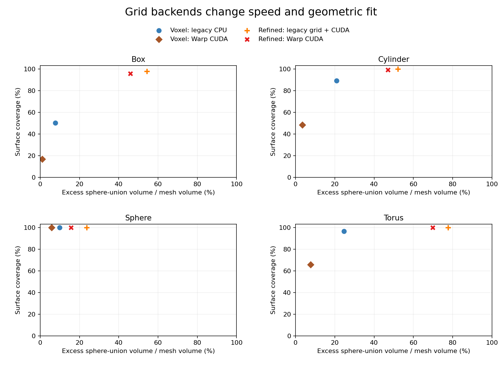

# v0.3：易用接口、可读性与几何查询优化

日期：2026-11-03。默认算法、默认 CPU 后端及旧参数保持兼容；本轮新增的原 mesh 距离后端仍为显式选择。以下把易用性变化、代码重构和性能实验分别说明。

## 更短的使用流程

```bash
assetspheres methods
assetspheres inspect examples/two_link.urdf
assetspheres fit examples/two_link.urdf --method slab
assetspheres view outputs/two_link/spheres.json
```

`methods` 列出算法与覆盖含义，避免依靠记忆选择方法；`inspect` 在拟合前显示每个 link 的几何来源、三角数、连通体数、闭合性和尺寸。两者都有纯 JSON 输出，便于脚本使用。

`fit` 的输出目录现在可省略，默认 `outputs/<输入文件名>`；重复运行仍需显式 `--force`。完成后直接打印带 shell 路径引用的 `report` 和 `view` 命令。帮助按输入、输出、算法、CPU/CUDA、体素化和 refined 六组组织，并显示有意义的默认值。旧的 `-o` 和全部旧命令参数仍然可用。

详见 [CLI 文档](cli.md) 与 [Python API](api.md)。Python 基础流程仍是：

```python
asset = load_asset(input_path)
configuration = FitConfig(method="cover-tight", count=24, padding=0.002)
result = fit_asset(asset, configuration)
write_outputs(asset, result, output_directory)
```

## 源码可读性

原先混合体素化、候选生成、贪心和评价的长函数已拆分为有明确职责的阶段：

```text
fit_mesh
  ├─ _prepare_mesh
  ├─ _resolve_configuration
  ├─ _fit_with_method
  │    └─ _prepare_voxel_grid → _prepare_voxel_candidates → _select_covering_candidates
  └─ _quality_report
```

内部变量采用 `configuration`、`point_samples`、`sphere_centers`、`candidate_radii` 等几何语义名。refined 训练准备、损失、CPU 梯度和 CUDA 目标分别组织，学习率、覆盖权重及数值界限使用具名常量。公开函数和已有关键字参数保留兼容。

重构前后对 box、cylinder、torus、全部 CPU 方法、CUDA voxel/refined 与 mesh-reference refined 共 **27 组完整球参数和报告逐项比较，全部相同**。资源管理调整另对 Open3D CPU、Warp CPU/CUDA 的 9 组占据、变换、clearance 和 metadata 比较，也没有改变数值结果。

## 新后端的选择

| voxelizer | 准备方式 | 查询设备 | 保持原球结果 |
| --- | --- | --- | --- |
| `subdivide`（默认） | 三角细分、表面壳填充、EDT | CPU | 是，默认回归保持 |
| `open3d` | 严格内部中心采样、原 mesh 数值距离 | CPU | 否，采样和半径语义不同 |
| `warp` | 严格内部中心采样、原 mesh 数值距离 | CPU / CUDA | 否，采样和半径语义不同 |

```bash
python -m pip install -e '.[open3d]'
assetspheres fit part.stl --voxelizer open3d

python -m pip install -e '.[warp,cuda]'
assetspheres fit part.stl --method refined --voxelizer warp --device cuda \
  --count 24 --padding 0.003
```

CUDA 张量阶段仍需可运行的 PyTorch。Open3D 的 RaycastingScene 不因 `open3d.core.cuda.is_available()` 为真就支持 CUDA；本项目明确在 CPU 运行它。Warp extra 固定为本轮测试的 1.19 系列，CPU 模式不需要 PyTorch。

新后端把 mesh 和最终物理格点居中归一化后转换为 float32，用三条射线的奇偶多数判断符号，并直接以内部距离减数值裕量作为候选半径；因此省掉了该路径的三角递归细分和 EDT。这些距离仍是数值近似，不是精确谓词或覆盖证书。

默认 `single` 拒绝猜测多闭合壳的含义。显式 `union-components` 将各壳分别作为实体查询，再取并集，其 clearance 是各实体内部距离的最大值，即并集内接半径的下界；它会填实由嵌套壳表示的空腔，也不能恢复原 URDF collision 的部件分组。

## 完整拟合耗时

本机为 Ryzen 9 9950X / RTX 5090 D v2；工作站仍有桌面和另一个 GPU 程序，没有独占隔离。配置为最多 24 球、resolution 48、padding 3 mm，完整 `fit_mesh` 包括网格/BVH 准备、候选选择与报告，不包括源文件读取和导出。预热后 3 次取中位数，CUDA 前后同步，传输包含在调用内。

单位 ms；这些列是**不同采样语义的完整方案对比**，不是同一个球结果的纯实现替换：

| 形状 | 旧准备 + CPU | 旧准备 + CUDA 张量 | Open3D CPU | Warp CPU | Warp CUDA |
| --- | ---: | ---: | ---: | ---: | ---: |
| Box | 51.8 | 40.8 | 68.0 | 29.9 | 8.7 |
| Cylinder | 461 | 416 | 53.1 | 31.4 | 6.7 |
| Sphere | 38.2 | 31.0 | 305 | 251 | 18.2 |
| Torus | 84.1 | 77.7 | 83.0 | 66.9 | 32.7 |

旧 CPU 准备对长三角形的反复细分是圆柱瓶颈；直接 BVH 距离查询在这类输入上很有价值。Sphere 的 Open3D / Warp CPU 距离查询反而更慢，不能认为新后端普遍更快。

单独启动全新 Python 进程处理同一圆柱，旧 CPU 为约 0.760 s，Open3D CPU 约 1.354 s，Warp CPU 约 0.666 s，Warp CUDA 约 1.827 s。这里磁盘编译缓存已经存在，不代表第一次无缓存 JIT；首次依赖导入、上下文准备仍可能抵消一次性小任务的收益。

## 质量与速度一起判断

最终确认使用新种子 99103：同一形状的全部模型共用 6,000 个独立表面点、20,000 个体积点和包含全部球的共同评价域。体积分类以原闭合三角 mesh 为参考；没有利用这些确认点调权。数值是 Monte Carlo 估计，有效内部样本数保存在[完整快照](voxelizers-2026-11-03.json)。

| 圆柱方案 | 表面覆盖 | 实体覆盖 | 外扩/原体积 | IoU | 热拟合 |
| --- | ---: | ---: | ---: | ---: | ---: |
| voxel，旧 CPU | 89.2% | 98.6% | 20.9% | 0.816 | 461 ms |
| voxel，Warp CUDA | 48.4% | 93.2% | 3.5% | 0.900 | 6.7 ms |
| refined，旧准备 + CUDA | 100% | 100% | 52.0% | 0.658 | 480 ms |
| refined，Warp CUDA | 99.1% | 100% | 47.1% | 0.680 | 117 ms |

严格内接距离降低了外扩，但原始 voxel 的表面覆盖也下降；圆柱 IoU 较高并不抵消漏碰撞风险。`refined` 在这组圆柱数据上较好地保留覆盖并降低完整耗时，但它仍不是保守包络。若需要有几何前提的完整包络，可使用 `slab` / 表面包络方法并检查其外扩。

Box 的 Warp 原始 voxel 同样有明显欠覆盖：表面覆盖约 17%、实体约 80%，不能因为速度更快就用作默认方案。Torus 的 refined+Warp 本轮保持表面与内部样本覆盖，并把外扩估计从约 78% 降至约 70%；这个示例不能作为所有复杂资产的保证。



## 本轮补上的质量与资源边界

- **薄结构**：某闭合组件没有内部格点时明确报错，不静默删除；内部有格点也不等于最终会被采样保留。
- **小组件**：每组件最深内部代表点加入候选；先覆盖代表点，再用剩余预算覆盖整体样本。预算不足，或优化后代表点丢失时明确失败。它不是整个组件的覆盖保证。
- **大坐标**：查询点先按最终球心相同的物理坐标重建，再归一化；半径还减去坐标 ULP 相关裕量。格距接近世界坐标精度时要求移近原点或增大格距。平移到 `1e12` 的 box 已纳入测试。
- **资源生命周期**：本项目的 Warp 几何准备、同步与释放使用专用锁串行化，避免并发分配/销毁及在飞对象释放；返回 NumPy 数据拥有独立内存。Open3D 的独立 scene 保持并行。此锁不管理调用方自己启动的其他 Warp 工作。[官方并发问题](https://github.com/NVIDIA/warp/issues/1491)说明了采用这一保守资源约定的原因。
- **有界数组**：格点数在分配前检查，查询分批执行；该预算不包含 mesh/BVH、运行时或其他进程的总内存。

普通 `ray + fill` 没有接入产品：本轮反例中它漏掉了 box/cylinder 的大量内部。SDF 表面膨胀带也只用于研究脚本，未作为“严格内部”模式的隐藏修复。原始探索与多壳/薄片反例见 [voxelization-research.md](voxelization-research.md)。

## 复现

```bash
python -m pip install -e '.[dev,quality,plots,open3d,warp,cuda]'
PYTEST_DISABLE_PLUGIN_AUTOLOAD=1 pytest -q

python benchmarks/benchmark_voxelizers.py \
  --method voxel --method refined --repeats 3 --cold --evaluation-seed 99103
python benchmarks/render_voxelizer_results.py --date 2026-11-03
```

新后端依赖按需导入，基础安装与默认 CLI 不加载 Open3D、Warp 或 PyTorch。本轮未改原生 Lula，也未把这些原型在 cuRobo / RMPflow 的规划运行中验证为碰撞性能提升。
